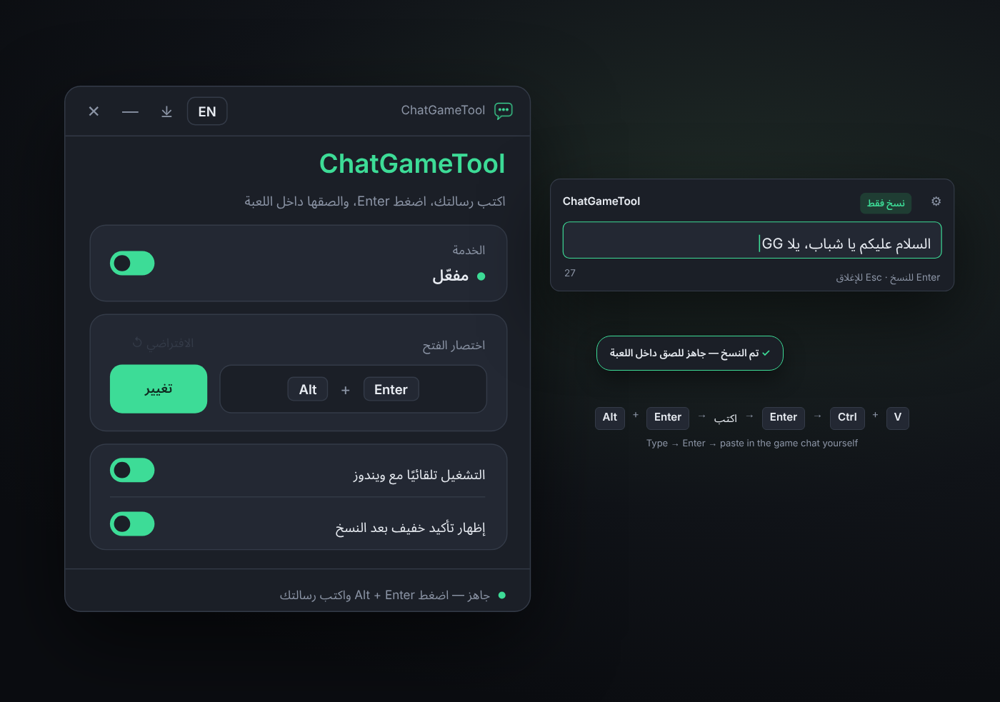

# ChatGameTool

<b>اكتب رسالتك براحتك بأي لغة، والصقها في شات اللعبة.</b>

<b>Type your message comfortably in any language, then paste it into the game chat.</b>

<kbd>Alt</kbd> + <kbd>Enter</kbd> &nbsp;→&nbsp; <bdi><b>السلام عليكم يا شباب</b></bdi> &nbsp;→&nbsp; <kbd>Enter</kbd> &nbsp;→&nbsp; <kbd>Ctrl</kbd> + <kbd>V</kbd>

 

## [⬇️ تحميل ChatGameTool لويندوز · Download for Windows](https://github.com/AzooozeM/ChatGameTool/releases/latest/download/ChatGameToolSetup.exe)

مثبّت صغير · بدون صلاحيات مسؤول · مجاني

Small installer · No admin rights · Free

 

---

## العربية

### طريقة الاستخدام

1. **حمّل** `ChatGameToolSetup.exe` من الزر فوق.
2. **ثبّته وشغّله**. تظهر أيقونته جنب الساعة.
3. **داخل اللعبة** اضغط <kbd>Alt</kbd> + <kbd>Enter</kbd>، اكتب رسالتك، واضغط <kbd>Enter</kbd> عشان تنسخها.
4. **افتح شات اللعبة** بنفسك، والصق بـ <kbd>Ctrl</kbd> + <kbd>V</kbd>، ثم <kbd>Enter</kbd>.

### المميزات

- **أي لغة**: عربي، إنجليزي، رموز وإيموجي. النص يُنسخ مثل ما كتبته بالضبط.
- **يرجّعك للعبة تلقائيًا** بعد النسخ، بدون ما تلمس الماوس.
- **اختصارك أنت**: اختر أي اختصار يناسبك، وينبّهك لو اخترت زر يأثر على الكتابة. وفيه زر يرجّعه للافتراضي.
- **آمن مع الألعاب**: ما يلمس اللعبة أبدًا. لا يلصق ولا يضغط أي زر بدالك، ولا يقرأ ذاكرة اللعبة. أنت اللي تلصق وترسل بنفسك.
- **خفيف جدًا**: مكتوب بـ Rust، وما يستهلك المعالج وهو ينتظر.
- **الواجهة بالعربي والإنجليزي**.
- **تحديثات موقّعة رقميًا**: كل تحديث يُتحقق منه قبل التثبيت، وتقدر توقف التحديث التلقائي من الإعدادات. وإعداداتك ما تتغيّر مع التحديثات.

### ملاحظات

- إذا كانت اللعبة بوضع ملء الشاشة الحصري (Exclusive Fullscreen) ممكن تتصغّر لما تظهر النافذة. استخدم **Borderless**.
- لو كان الاختصار <kbd>Alt</kbd> + <kbd>Enter</kbd> والتطبيق مقفول، يوصل للعبة ويبدّل ملء الشاشة. فعّل «التشغيل تلقائيًا مع ويندوز».

### إذا ظهر لك تحذير

البرنامج جديد وغير موقّع بشهادة تجارية بعد، فويندوز ممكن يعرض «Windows protected your PC»: اضغط **More info** ثم **Run anyway**.

### الخصوصية

لا يحفظ رسائلك، ولا يقرأ الحافظة، ويستبعد الرسالة المنسوخة من سجل الحافظة (<kbd>Win</kbd> + <kbd>V</kbd>). اتصاله الوحيد بالإنترنت للتحقق من التحديثات.

---

## English

### How to use

1. **Download** `ChatGameToolSetup.exe` from the button above.
2. **Install and run it.** Its icon appears next to the clock.
3. **In the game**, press <kbd>Alt</kbd> + <kbd>Enter</kbd>, type your message, and press <kbd>Enter</kbd> to copy it.
4. **Open the game chat** yourself, paste with <kbd>Ctrl</kbd> + <kbd>V</kbd>, then press <kbd>Enter</kbd>.

### Features

- **Any language**: Arabic, English, symbols and emoji. The text is copied exactly as you typed it.
- **Takes you back to the game** after copying, no mouse needed.
- **Your shortcut, your choice**: pick any shortcut you like. It warns you if a key would get in the way of typing, and one click resets it to the default.
- **Safe with games**: it never touches the game. No automatic paste or key presses, no reading game memory. You paste and send yourself.
- **Very light**: written in Rust, uses no CPU while it waits.
- **Arabic and English interface.**
- **Digitally signed updates**: every update is verified before installing, and you can turn automatic updates off. Your settings never change with an update.

### Notes

- In Exclusive Fullscreen the game may minimize when the window appears. Use **Borderless**.
- If your shortcut is <kbd>Alt</kbd> + <kbd>Enter</kbd> and the app isn't running, the key reaches the game and toggles fullscreen. Turn on "Start with Windows".

### If you see a warning

The app is new and not commercially code-signed yet, so Windows may show "Windows protected your PC": click **More info**, then **Run anyway**.

### Privacy

It never stores your messages, never reads the clipboard, and keeps copied messages out of clipboard history (<kbd>Win</kbd> + <kbd>V</kbd>). It only goes online to check for updates.

---

مشكلة أو اقتراح؟ <a href="https://github.com/AzooozeM/ChatGameTool/issues">افتح بلاغ</a>

Found a problem? <a href="https://github.com/AzooozeM/ChatGameTool/issues">Open an issue</a>

